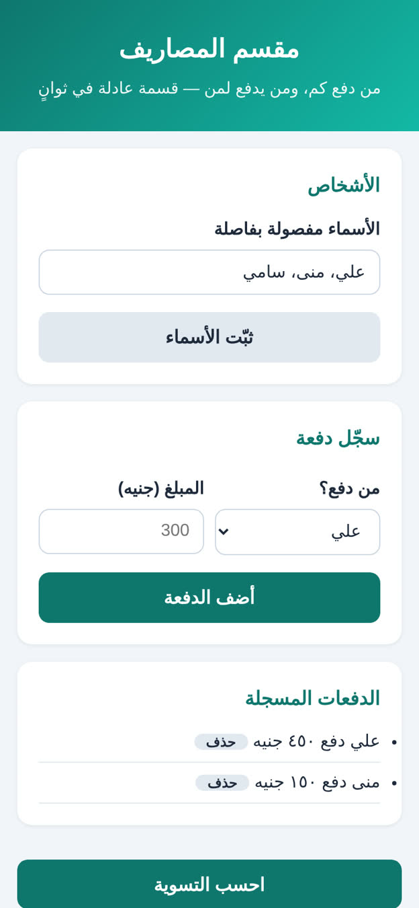

# Expense Splitter | مقسم المصاريف

Split shared expenses between friends: record who paid what and see exactly who owes whom. Arabic interface.

**Live app:** https://abood-ayman.github.io/expense-splitter-ar/

This is a personal project, built with AI tools.

## Features
- Record each person and what they paid; equal split is automatic
- Computes each person's share and balance
- Suggests the fewest transfers to settle everyone up
- Great for trips, travel, shared flats and events

## Privacy
Everything runs in your browser. No data is stored or sent anywhere.

## Run locally
Open `index.html` in any browser. It is a single static page with no dependencies.

## Status
Stable.

## Copyright
MIT License - Copyright (c) 2026 Abdullah Ayman.
